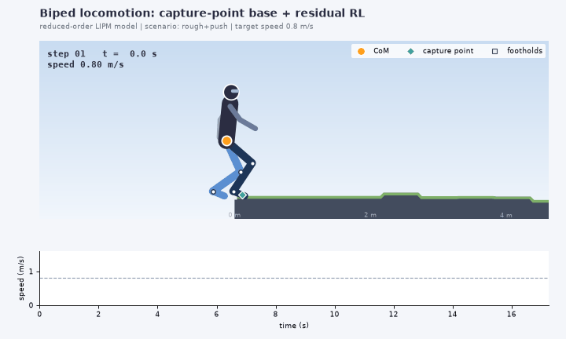
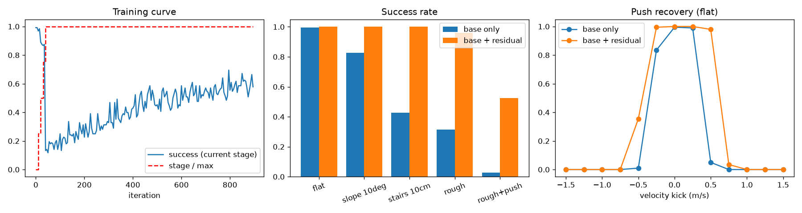

# Bipedal Locomotion with Residual RL + Terrain Curriculum

A lightweight bipedal walking project built from scratch in pure Python. A classical capture-point controller does the basic walking, a small neural network learns residual corrections on top of it, and a terrain curriculum (flat, slopes, stairs, pushes) teaches it to handle harder conditions step by step.

No physics engine, no GPU, no PyTorch. Just NumPy and Matplotlib. Training takes about 13 minutes on a normal laptop and uses well under 1 GB of RAM.



## Highlights

- **Reduced-order biped:** a planar linear inverted pendulum (LIPM) with closed-form step-to-step dynamics, so there is no integrator and no contact solver.
- **Classical base + learned residual:** the base controller is a deadbeat capture-point stepper. The policy only adds small, bounded corrections, so it can't easily wreck a working gait.
- **Terrain curriculum:** five stages with automatic promotion, plus replay of earlier stages to avoid forgetting.
- **Fast training:** augmented random search (ARS), with hundreds of robots simulated at once as NumPy arrays.
- **Built-in evaluation:** success rate, distance, speed error, effort, and a push recovery curve, all compared against the base controller alone.

## Results

Evaluated on 500 fixed-seed episodes per scenario, after 900 training iterations. "Base" is the capture-point controller alone. "Residual" is base plus the learned policy.

| Scenario | Success (base) | Success (residual) | Speed error (base) | Speed error (residual) |
|---|---|---|---|---|
| Flat | 100% | 100% | 0.20 | 0.06 |
| Slope, up to 10° | 83% | 100% | 0.30 | 0.08 |
| Stairs, up to 10 cm | 43% | 100% | 0.30 | 0.11 |
| Rough (12° + 15 cm) | 31% | 96% | 0.34 | 0.12 |
| Rough + random pushes | 3% | 53% | 0.40 | 0.18 |

Speed error is the mean absolute difference from the 0.8 m/s target, in m/s.



## How it works

### Model

The robot is a point-mass inverted pendulum with a swing foot. During one step the center of mass (CoM) follows

```
x'' = w^2 (x - p),    w = sqrt(g / z_c)
```

where `p` is the center of pressure under the stance foot. This has a closed-form solution, so one environment step equals one footstep. At touchdown the stance foot swaps and the velocity carries over.

Terrain is a height profile `h(x)`. Stepping up costs kinetic energy and stepping down gains some:

```
v_next^2 = v_end^2 - 2 * g * 0.25 * dh + e
```

`dh` is the height change between feet and `e` is the push-off energy chosen by the residual policy.

### Control

**Base controller.** Capture-point (divergent component of motion) stepping with a nominal model. It places the next foot so the capture point lands on the offset needed for the target speed. On flat ground it walks well by itself.

**Residual policy.** A 2x32 tanh MLP that makes one decision per footstep. Its output is bounded and added to the base command.

| Observation (10) | Description |
|---|---|
| velocity error | current speed minus target |
| CoM offset | CoM position relative to the stance foot |
| capture point | CoM position plus velocity / w |
| terrain lookahead (3) | height of the ground 0.35, 0.70 and 1.05 m ahead, relative to the stance foot |
| previous action (4) | last residual output |

| Action (4) | Range |
|---|---|
| foot placement offset | ±0.10 m |
| step duration offset | ±0.06 s |
| CoP shift | ±0.04 m |
| push-off energy | ±1.0 m²/s² |

**Reward.** Tracks target speed, penalizes action size and push-off effort, gives -3 for a fall. A fall means the robot stalls, can't get its foot under itself, or faces a step too high to climb.

**Why the residual has something to learn.** The simulator adds foot placement noise (1.5 cm) and randomizes leg height by ±10%, while the base controller assumes nominal values and has no terrain awareness.

### Curriculum

| Stage | Terrain | Pushes |
|---|---|---|
| 0 | flat | none |
| 1 | slopes up to 10° | none |
| 2 | stairs up to 10 cm | none |
| 3 | slopes up to 12° and stairs up to 15 cm | none |
| 4 | same as stage 3 | random velocity kicks up to 0.5 m/s |

Each training batch draws 60% of its terrains from the current stage and 40% from earlier ones. The policy is promoted when the success rate stays at 85% or higher for two evaluations in a row. If training collapses, it rolls back to the best checkpoint of the current stage.

### Training

Augmented Random Search (ARS) with mirrored perturbations. All perturbed policies and all terrains run together as one batch of NumPy arrays, which is why a full run is so cheap.

## Installation

Requires Python 3.9 or newer.

```bash
git clone <your-repo-url>
cd <your-repo-folder>
python -m venv .venv

# Windows
.venv\Scripts\activate
# macOS / Linux
source .venv/bin/activate

pip install -r requirements.txt
```

## Usage

Everything lives in `biped_residual.py`.

```bash
# Train, evaluate and render the animation in one go
python biped_residual.py all --iters 900

# Or run the steps separately
python biped_residual.py train --iters 900      # saves theta.npz
python biped_residual.py eval                   # prints the table, saves results.png
python biped_residual.py animate                # saves walk.gif
```

| Option | Default | Description |
|---|---|---|
| `--iters` | 300 | Training iterations. Use 900 or more for push recovery. |
| `--seed` | 0 | Random seed. |

`eval` and `animate` read `theta.npz`, so run `train` first.

Training time on a regular laptop: roughly 4 minutes for 300 iterations and 13 minutes for 900.

### Outputs

| File | Contents |
|---|---|
| `theta.npz` | Trained policy weights and training history |
| `results.png` | Training curve, success per scenario, push recovery curve |
| `walk.gif` | Animation of a demo episode |

### Useful parameters

These are near the top of `biped_residual.py` or in the `train()` signature.

| Name | Meaning |
|---|---|
| `STAGES` | Curriculum definition (slope, stair height, push size) |
| `LAM` | How much of a height change the CoM feels as energy |
| `nd`, `E` | Number of ARS directions and terrains per iteration |
| `nu`, `lr` | ARS exploration noise and step size |
| `promote` | Success rate needed to advance a stage |

## Project structure

```
.
├── biped_residual.py   # environment, base controller, policy, training, eval, animation
├── requirements.txt
├── README.md
├── LICENSE
├── results.png
└── walk.gif
```

## Evaluation scenarios

- Success rate over 500 fixed-seed episodes (the robot survives 60 steps)
- Mean distance walked
- Mean absolute speed error
- Push-off effort per meter
- Push recovery curve: success rate against a single velocity kick of -1.5 to +1.5 m/s on flat ground

## Limitations

Please read these before drawing conclusions from the numbers.

- **Reduced-order model.** This captures stepping and balance logic. It does not model joints, torques, foot contact or body dynamics, and it is not a drop-in controller for a real robot.
- **Simplified terrain energy model.** Climbing cost is a fixed fraction of the height change. It is meaningful for comparing controllers, but it is not contact physics.
- **Single training run.** The results above come from one seed. Push recovery in particular varied between runs during development (roughly 34% to 53%), so treat that number as indicative.
- **Push recovery is the weakest part.** About half of the rough-plus-push episodes still fail.
- **Effort for the base is zero by construction.** The base controller never uses the push-off action, so that column only measures the residual.
- **Shorter distance on flat ground.** The residual covers less distance than the base on flat terrain (about 18 m vs 22 m) while tracking speed more closely. The likely cause is a slightly slower gait, but a signed speed metric has not been added yet to confirm it.
- **The demo GIF is hand-picked.** The script searches for an episode that survives, gets pushed and crosses a stair, so it shows a successful run, not an average one.

## Roadmap

- [ ] Multi-seed training with mean and spread
- [ ] Ablations: no curriculum, no terrain lookahead, no replay of earlier stages
- [ ] Signed mean speed metric
- [ ] PPO implementation for comparison with ARS
- [ ] Swing-leg dynamics and foot clearance checks
- [ ] Planar model with knees and torso, or a simplified 3D model

## Contributing

Contributions are welcome, whether that's a bug fix, a new experiment or better documentation.

1. Fork the repository.
2. Create a branch: `git checkout -b feature/short-description`.
3. Make your changes. Keep the project lightweight: NumPy and Matplotlib are preferred, and new dependencies should have a good reason.
4. Run `python biped_residual.py all --iters 300` to make sure training, evaluation and the animation still work.
5. Follow PEP 8 where practical and add a short comment for anything that isn't obvious.
6. Commit with a clear message and open a pull request describing what changed and why. If you changed the dynamics or reward, include before and after evaluation numbers.

For bugs, open an issue with your Python version, the command you ran and the full error output. Ideas from the roadmap above are a good place to start.

## License

This project is released under the MIT License. See [LICENSE](LICENSE) for details.

## Acknowledgements

Built on well-known ideas: the linear inverted pendulum model, capture-point (DCM) stepping, residual policy learning, and Augmented Random Search (Mania et al., 2018).